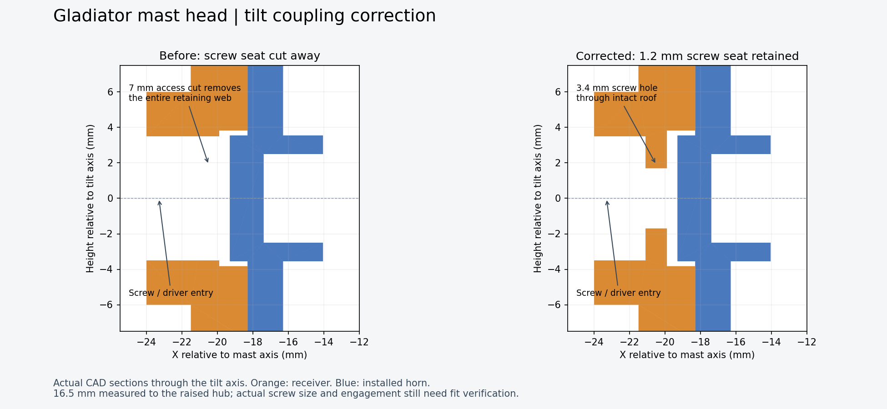

# Gladiator mast-head review — 5 October 2026

This is an isolated correction of the current v0.4 head, using the confirmed **16.5 mm ear underside to raised horn hub** measurement. Open `candidate/Gladiator_Head_v04_PanStack.FCStd` for the complete assembly. The existing master and concurrent v0.4 work were preserved.

## Corrected

1. **Tilt horn screw retention.** The 16.5 mm horn update moves the receiver's screw-bearing roof to X -21.1..-19.9 in mast-relative coordinates. The previous fixed driver cut ended at -18.5 and removed that roof entirely. The cut now ends at the derived roof face, preserving the intended 1.2 mm thickness. The solid check verifies the whole bearing annulus, not merely a valid or collision-free part.
2. **Open screw passage after fusion.** The supporting arm was fused after the horn plate's screw hole was cut. Restoring the roof exposed a 0.1 mm diaphragm across the hole. A final clearance cut through the completed union clears it. A separate shank probe verifies the passage.
3. **Belt adjustment checks.** The belt reference now follows the carriage at both ends of its travel. Previously it remained at nominal spacing during those checks. This remains a taut belt envelope; it does not model a loose belt's sag or prove installation over the flanges.
4. **More complete validation.** Tilt is sampled every 5 degrees over -25..25; pan every 5 degrees over -20..180. Both carriage-end checks include negative tilt. Missing robot references, blocked tilt-driver access, failed STL occupancy probes, non-solid/non-manifold meshes and excessive mesh volume error now prevent a passing build result.

The tested mast key, GH44 outline, bearing fits, pulley tooth profile and display pocket are retained. Among the 24 active assembly solids in the captured source, only **GH44_Tilt_Receiver** changes geometry. Its STL is in `candidate/stl/`. The pan servo height already incorporates the current measurement: ear underside Z 146.7 in robot coordinates.

## Remaining design work

- **Sensor attachment:** ToF/radar mounting interfaces are still undefined; the carrier remains incomplete. Do not infer actual mounting holes from the reference envelopes.
- **Harness and travel stops:** the 12 mm axial route is preserved, but flexible routing, strain relief and mechanical stops are not designed. A straight bore check is not a moving-harness check.
- **Horn screws:** check actual head diameter and available thread engagement through both printed adapters. The 4 mm head used in the bearing-material check is an assumption; the original servo screw has not been verified in the full stack.
- **Bearing spacer:** the 9 mm inner-race spacer is modeled as reference hardware. Availability and contact against the actual inner races remain unresolved; it is not included as a newly released printed part.
- **Display:** the board-pocket fit passed. Final window alignment and corner-screw fit remain unreported.
- **Load and wear:** no payload, stiffness, thermal or durability rating is established. The M3 tilt pivot runs in printed PLA.

The 39.75 mm nominal carriage position is a fit-based starting point, not an exact belt-length constraint: its ideal pitch path is 180.522 mm for a nominal 180 mm belt. Set tension with the actual belt using the slots; do not force the carriage to that position or its outer stop.

The updated v0.4 Plate 3 receiver must incorporate **both** screw-seat and screw-passage corrections. This package does not start a print or replace files in the printer queue. No extra coupon was created.

## Evidence and rebuilding

- `baseline-audit.json`: original screw-bearing volume was zero versus 4.184601 mm3 expected for the assumed head.
- `candidate/validation.json`: motion, optical-envelope, cable-bore and STL checks.
- `candidate/artifact-verification.json`: native and STEP reopen checks, plus an exact solid comparison to the captured source.
- `build_head_v04_source.py`: captured input, preserved for provenance.
- `prepare_candidate.py`: guarded transformations producing `build_head_review.py`.
- `build_head_review.py`: complete generator for this candidate, using the existing v0.3 sensor references and current robot master on the CAD workstation.
- `verify_and_package.py`: independent artifact checks.

On the CAD workstation, in `cad/head/review-20261005/`, run `/usr/bin/python3 prepare_candidate.py`, then `/usr/bin/python3 build_head_review.py`, then `/usr/bin/python3 verify_and_package.py`. Source paths intentionally point to the existing CAD repository. `render_review.py` produces the section illustration from the actual solids. `finalize_review.py` replaces inherited stale status prose, writes SHA-256 hashes and packages the deliverables; it does not change geometry or numeric check results.

## Completed verification

- **117,950 distinct part/pose comparisons:** 39,024 within the head, 66,386 against 19 robot solids, and 12,540 at the carriage ends. No detected rigid-solid collisions.
- Pan -20..180 and tilt -25..25 sampled in 5-degree steps; carriage ends additionally checked at 20-degree pan steps and tilt -25/0/25. No modeled ToF intersections.
- All 24 active assembly parts are single valid solids. All 11 exported STL meshes are solid and manifold, sit on Z=0, and pass occupancy probes.
- Reopened native and STEP files pass; STEP has 24 solids and relative volume difference below 0.000001%.
- Exact solid comparisons confirm that only the receiver changes versus the captured source. The saved receiver retains the expected 4.184601 mm3 screw-bearing annulus, and the shank probe intersects zero material.
- Saved master and v0.3 input hashes are unchanged.

Sampled clearance checks cannot establish clearance between samples, real wiring behavior, optical performance or physical print fit. This is a reviewed CAD candidate, not release of the unfinished complete mechanism.

