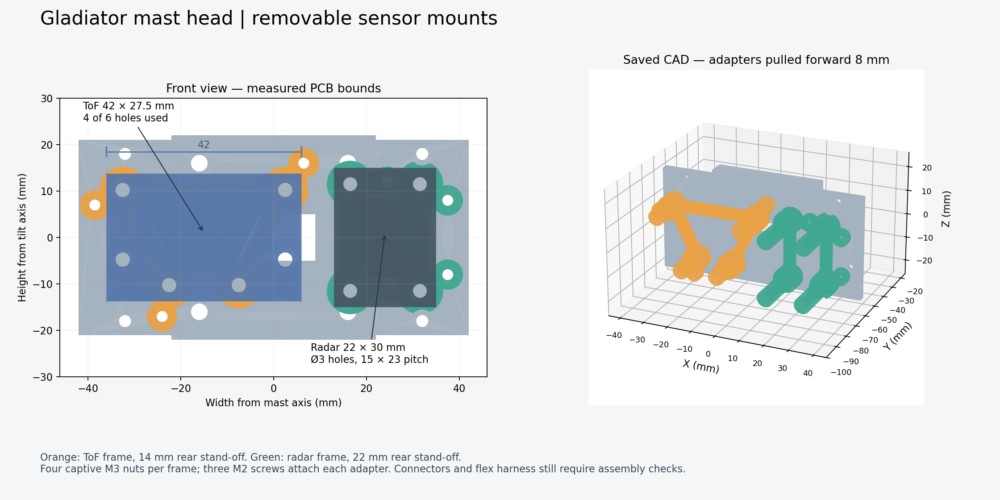

# Gladiator mast head — measured sensor mounts, 2026-10-05

**Robot-frame update, 2026-10-09: mast is FRONT (+Y); +X right, +Z up.**
See ../../../docs/ORIENTATION.md. This manufacturing source and its historical
images remain at legacy construction pan0 (-Y sensor direction), not the new
robot-forward pose. Use ../master/Gladiator_Head_Master.FCStd to view the unchanged
parts facing +Y at checked legacy pan180. This is the existing travel endpoint,
not a centered servo home. Print meshes, hole patterns, and plates are unchanged.

This v05 prototype adds removable mounts for the actual **42 x27.5 mm laser board** and
**22 x30 mm presence detector**. The radar's corner holes are diameter3, with2 mm edge
gaps: centers3.5 from each edge, **15 x23 mm pitch**. Radar is upright,30 mm tall.
The laser mounting holes come from the official SEN0628 dimension drawing. Four of
its six holes are used: top two and bottom two. No dimensions were scaled from photos.

The carrier is84 mm wide and keeps the tested GH44 key and mounting interface.
Each adapter uses four M3 screws with side-loaded captive nuts and three M2 screws
from the carrier rear. ToF rear stand-off14 mm; radar22 mm. These include room for nut
feet as well as the component reservations. The measured8 mm radar rear components
have11 mm clearance to the nearest nut foot. The ToF uses a conservative9.9 mm rear
reservation from the published11.5 mm whole stack and1.6 mm PCB.
The radar is10 mm farther forward than the first candidate: its wider field otherwise
reached the S3 board and antenna at25 degrees downward tilt. The full tilt range is retained.

The corrected tilt receiver retains the1.2 mm horn screw seat and fully open passage.
All other mechanical parts match the reviewed v04 exactly; the master is unchanged.

## Files and checks

Native FreeCAD and STEP include26 valid single assembly solids at real robot position.
All13 print-oriented STL files are solid/manifold, onZ0, with valid feature probes.
**145,817 sampled part/pose comparisons pass**, pan-20..180 and tilt-25..25 degrees
every5 degrees; both carriage ends include negative tilt. No detected rigid collision,
ToF or radar field-reservation obstruction, or axial cable-probe overlap. Field checks
use whole-board lateral bounds at assumed front planes. Lens/antenna planes remain
unmeasured; these checks do not establish radar RF performance.
The first rigid/ToF sweep covered all comparisons. After the radar adjustment,
24 unchanged solids were proven identical by exact BRep symmetric difference before
reusing their comparisons; every pair involving the two changed radar solids was
retested. The radar field was swept again over every pose. See validation_reuse in
validation.json for fresh/reused counts and baseline hashes.
Saved native/STEP files independently reopen and the expected five changed/added
objects are verified. Every Plate5 triangle matches its canonical STL within export
precision; the plate fits the220 x220 bed and has no overlapping footprints.

**Plate5: carrier + ToF frame + radar frame.** Carrier sensor face down/key up; adapters
carrier-mating face down/posts up. No supports; small nut-slot roofs bridge6 mm.
PLA,0.2 mm layers,4 walls,30–40% infill. Use brim if needed. Do not auto-orient.
The3MF carries geometry, not a printer profile. The corrected v04 Plates1–4 are included
in mechanical-plates-v04/; see its instruction sheet for their support requirements.
No print was started or new coupon made.

## Fasteners and assembly

Nominal sensor fasteners: **ToF4 x M3 x16; radar4 x M3 x25;8 M3 nuts**. Adapter fasteners: **6 x M2 x6**,
head diameter at most4.5 mm and height at most2.6 mm. M2 machine screws form threads
in the tested2.35 mm pilots. M3 printed passages are3.6; nut pockets6.0AF x2.6 deep.
No washer is assumed under the PCB screw heads; a washer changes required screw length.
Check actual screw lengths, head lands and connector orientation before tightening.

1. Build the v04 mechanical head; yoke-to-pedestal bolts go in before tilt servo/receiver.
2. Slide M3 nuts into the ToF frame from each post's outboard slot. Attach this frame
   to the carrier with3 M2x6 from rear **before fitting the carrier**.
3. Attach carrier to receiver with4 M3; radar frame and both PCBs must still be absent.
4. Fit the radar frame's nuts, then attach it with3 M2x6 from rear, **before display frame**.
5. Attach rear display frame with4 M2 from front. Adapter reliefs provide a passage for
   a screwdriver shaft up to4.8 mm diameter. Fit the screen as described by v04.
6. Fit sensor PCBs last: ToF4 M3x16, radar4 M3x25. Route leads, then check complete unpowered
   pan and tilt motion before energizing the servos. For carrier removal reverse this order.

CAD probes verify all8 PCB screw passages, intact seating annuli, nut insertion sweeps,
adapter pilots and all11 relevant screwdriver paths for this assembly order.

## Remaining physical checks

Radar PCB thickness1.6 mm and front reservation8 mm remain assumptions. ToF uses its
rectangular outer envelope including ears, deliberately over-reserving the cutouts.
Both boards need a component-free3.5 mm radius mounting land around each hole. Plugged
connector outlines, wire bends and precise optical/antenna positions are not measured.

The complete flex harness, strain relief and mechanical stops remain unfinished.
Actual horn screw fit, belt installation/alignment/tension,9 mm inner-race spacer stock,
display window alignment and loaded stiffness need actual assembly checks. No payload
or torque rating is claimed. Swept checks are samples, not proof between samples.

Provenance: measurements/mast-head.md; sensor_mounts in validation.json; source
scripts/build_head_v05.py. DFRobot drawing: https://wiki.dfrobot.com/sen0628/.
