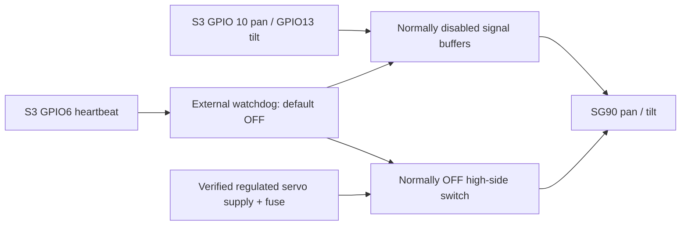

# Final integration and safe mast commissioning — 2026-10-14

This is integrated and OTA-deployed firmware, with mechanical acceptance pending. Jim reports
the assembled S3, C6, ESP32-CAM and TFT are working, and identifies both installed
servos as **SG-90**. That supersedes the October 13 unwired-screen/camera-fault
status. The S3, C6 and CAM were updated over Wi-Fi OTA without erasing NVS.
No servos or drivetrain were moved during this integration. See the
[deployment record](integration-deployment-20261014.md) for verified outcomes.

## Firmware behavior

- CAM 1.1.3 applies `(existing TFT rotation + 2) % 4`, so the TFT turns 180° even
  when a private LocalConfig supplies its original rotation. Panel geometry,
  rendering, OV2640 camera orientation, streaming, recovery and OTA stay intact.
  Keep the original rotation in LocalConfig; do not also add 180° there.
- C6 defaults to `192.168.8.2` only when no camera address is saved. Existing NVS
  configuration, including an intentionally empty address, wins. In the field
  page, **Start video** opens the existing direct `:81/stream` feed. Visual
  overrides remain display-only, temporary, and subordinate to stale/alert state.
- S3 owns mast calibration, reference, pulse mapping, rate limits, software
  bounds, replay checks, sensor reactions and shutdown. C6 only relays authenticated
  commands. Existing drivetrain control and battery policies remain intact.
- Mast outputs are off at boot. Calibration is volatile and must be supplied
  through physical S3 USB on every boot. No stored angle is treated as a position.
  Field/BLE/recovery control cannot attach or calibrate a servo.
- A deliberate USB reference starts a neutral hold, with 10 seconds for the
  operator to select **Maintain commissioned session**. Thereafter a fresh
  keepalive is required within 750 ms. Stop, expiry, link generation/transport
  change, lost link, unsafe power, drivetrain arming, or a > 100 ms control-loop
  gap removes the session/reference and PWM. Reconnection never re-enables it.
- Mast operation requires SAFE/disarmed stationary tracks, zero drivetrain
  targets, fresh healthy INA226 data (<250 ms), no battery motion inhibit, and
  an active S3/C6 link. Existing bench-power logic is retained. Mast and track
  motion are deliberately not simultaneous in this demonstration release.
- Scan is explicitly requested and bounded; it does not start automatically.
  Invalid/stale LiDAR, a valid return < 500 mm, or fresh radar presence stops the
  scan at its current commanded pose. Recovery does not restart a scan. Valid
  range alerts and radar greetings drive the existing visual policy; S3-reported
  mast scanning selects scanning eyes. LiDAR alone does not identify people.
- All field operations share one S3 controller. Angles are absolute, relative
  to a physically established head neutral; they never wrap or accumulate turns.
  Reported positions are **commanded estimates**, not measured SG90 positions.

## Pin and PWM audit

| Function | S3 GPIO / resource | Notes |
| --- | --- | --- |
| Pan signal | **10**, LEDC channel 4 | Through disabled-by-default signal buffer |
| Tilt signal | **13**, LEDC channel 5 | Through disabled-by-default signal buffer |
| Servo watchdog heartbeat | **6** | External normally-off power AND signal gate |
| Shared I²C SDA/SCL | **8 / 9**, 400 kHz | Retain existing sensor worker ownership |
| LEFT motor | EN2, PWM42/41, channels 0/1 | Unchanged, timer 0 |
| RIGHT motor | EN16/11, PWM17/12, channels 2/3 | Unchanged, timer 1 |
| C6 UART | TX4 / RX5 | Unchanged |
| Bench power | 7 | Unchanged |
| Status light | 48 | Unchanged |

Jim connected servo signals to GPIO10 and GPIO13; their physical axis assignment
is not yet verified. Pan10/tilt13 are provisional firmware names, not a finding
about the installed wiring. Identify each with linkage disengaged during the
isolated commissioning step. If reversed, exchange the two signal leads with
power OFF before applying the measured pan/tilt calibration. Do not use the
assembled mechanism to discover which output moves which axis.

GPIO6/10/13 are unused in the audited firmware and are exposed output-capable
pins on the [DevKitC-1 header](https://docs.espressif.com/projects/esp-idf/en/v4.4.6/esp32s3/hw-reference/esp32s3/user-guide-devkitc-1.html).
Confirm the actual expander headers are not connected to additional unrecorded
hardware. They avoid native USB19/20, UART43/44, straps0/3/45/46, N16R8
flash/PSRAM pins, and all assigned outputs. This is the **S3** GPIO map; CAM
GPIO13/14 display wiring belongs to a separate processor.

Channels 4/5 share dedicated LEDC timer 2, at the **verified** servo frequency,
14-bit duty resolution, and APB clock. Motor Arduino channels0/1 and 2/3 use
timers 0/1 respectively. No generic servo library can reallocate motor timers.
The S3 supports eight low-speed LEDC channels; see
[Espressif LEDC reference](https://docs.espressif.com/projects/esp-idf/en/v4.4.6/esp32s3/api-reference/peripherals/ledc.html).

## Required servo safety wiring

Two hobby servos have no position feedback. Firmware cannot know where they
were moved, prevent a servo's own internal power-up behavior, detect a slipped
belt, or remove servo power using a signal pin alone. **Do not enable mast motion
without the verified external gate.** Leaving motion disabled remains a usable
fixed-mast camera/display demonstration.

1. Give servos their own suitably rated regulated supply and fuse/current limit,
   selected from the actual installed units' voltage/current specifications.
   Do not power them from S3 3.3 V, USB, or an unverified shared logic regulator.
   Use common ground and route servo return current away from sensor returns.
2. Place a normally-off high-side power switch and disabled-by-default signal
   buffers between supply/GPIO10/13 and the servos. Buffer inputs must accept
   S3 3.3 V; output levels must suit the actual SG90 units. Prevent back-power
   through signal leads when servo power is off; use external pull-downs on the
   servo side and on gate control. A series resistor alone is not a power gate.
3. GPIO6 drives an external retriggerable watchdog/supervisor: alternating levels
   every 25 ms (rising edges every 50 ms) while the S3 session is enabled. Require
   timeout **at most 150 ms** after the last valid edge. A steady HIGH or LOW,
   S3 reset, power loss, and an unplugged heartbeat must all leave power and
   signal buffers OFF. A direct GPIO6-to-load-switch connection is unsuitable.
   The gate must start OFF and reject a lone startup edge; qualify multiple
   correctly spaced edges before enabling. Verify this with dummy loads/scope
   before connecting servos. This also covers a stalled loop while hardware PWM
   continues running independently.
4. Provide an accessible physical servo-power cutoff. Support/counterbalance the
   tilt head so loss of holding torque cannot cause a fall or collision. Disable
   PWM/power is not a mechanical brake. Do not back-drive an energized servo.



## SEN0628: 5 V power is not 3.3 V I²C

The vendor specifies 3.3–5 V supply. Its
[V1.0 schematic, sheet 4](https://dfimg.dfrobot.com/wiki/21121/SEN0628_rp2040-8-8-matrix_schematics_v1.0.pdf)
shows a 2N7002 dual-FET level shifter and connector-side 10 kΩ pull-ups to **VIN**.
With the sensor powered from deck-one 5 V, the Gravity connector can therefore
idle near 5 V. Its internal RP2040 runs near 3.3 V; that does **not** make the
external connector safe for the S3.

- Sensor VCC to regulated deck-one 5 V; sensor GND to common ground.
- Sensor SDA/SCL to the **5 V side** of a bidirectional I²C level translator
  rated for the existing 400 kHz bus. Translator low-side reference/pull-ups to
  S3 3.3 V; low-side SDA to GPIO8 and SCL to GPIO9. Keep existing 3.3 V devices
  on that low side. Never connect 5 V pull-ups directly to S3 pins.
- Before connecting GPIO8/9, measure both signal sides powered and idle;
  verify the S3 side stays near 3.3 V and has suitable rise times on the assembled
  bus. Inspect total parallel pull-ups rather than blindly adding more. If the
  installed board revision differs, inspect its circuit and measure it too.
- Confirm I²C mode/address selectors. The driver discovers 0x30–0x33 and requests
  8×8 mode. Keep the vendor startup settle delay (5 seconds), bounded reads and
  retries. No additional Wire owner or blocking ranging loop was added.
- Remove the protective film. The vendor's
  [firmware 1.3 guidance](https://wiki.dfrobot.com/sen0628/docs/21564) describes
  invalid-value fixes; record the installed module firmware and, if older,
  update it using the vendor procedure with S3 I²C disconnected and safe power.
  Sensor firmware was not changed in this session.

The existing SensorManager, typed RANGE telemetry and native 8×8 grid remain.
On the C6 `/dev`, select Range and request inspection to see all 64 native zones;
the normal field page shows the valid nearest distance. Bad transport/status,
short payloads, values below 20 mm, 4000/no-return, or larger invalid values cannot
produce valid detections. All-invalid frames are healthy communications with
`valid:false`, zero usable zones and zero derived nearest distance. Native
values remain available for diagnosis. A failure clears derived distance;
stale data loses detection validity. Visual alerts require healthy data younger
than 500 ms. Empty/invalid data means **unknown**, not a guaranteed clear path.
The sensor is a demonstration behavior input, not a certified collision sensor.

## First SG90 commissioning — do not home the assembled unknown mechanism

1. Disable drivetrain and servo supply; support the head. Mark the present cable
   route and untwist it manually with power OFF. Disconnect the pan belt/horn
   and tilt linkage as needed so an unknown servo position cannot drive the
   assembled mechanism. Never issue a presumed 1500 µs/90° home to the assembly.
2. Verify each actual unit is a positional SG90, its permissible supply voltage,
   logic threshold, pulse frequency, neutral pulse and usable pulse endpoints.
   Use a current-limited isolated servo tester with the linkage disengaged.
   Start only within that unit's documented/verified pulse range, advance in
   small steps, stop before hard stops/buzzing, and record the results. Firmware
   accepts only 50–100 Hz and 500–2500 µs as outer validation envelopes; these
   bounds are **not** usable-travel specifications and no defaults are loaded.
3. With each servo held at its measured neutral on the isolated tester, align
   the supported head and reconnect/index the linkage at that neutral without
   applying force. Record pan/tilt **head** angles versus pulses, including
   direction. The documented pan transmission is 60T servo /40T head, so it
   magnifies servo rotation 1.5× if that arrangement is still installed.
4. Inspect the full swept head, screen, carrier and cable bundle. The current
   CAD says mast-front is legacy pan 180, a travel endpoint. Do not silently
   assume forward permits symmetric movement. Use a verified **one-sided**
   interval if necessary, or perform a separate mechanical re-index/clearance
   review. A neutral at an endpoint is supported. No CAD changes are included.
5. Begin with no more than ±5° head pan/±3° tilt, or a smaller one-sided span,
   at 1–2°/second. Leave a mechanical/cable margin beyond software endpoints.
   Only widen after checking every intermediate pose, harness slack, power sag,
   backlash and tilt support. Firmware hard ceilings are ±45° head pan and
   ±20° head tilt; measured calibration may only be narrower. ±45° is a ceiling,
   not permission or the initial operating range.
6. Validate the gate/reset/loop-stall behavior with disconnected mechanical
   loads first. Confirm the servo supply/logic rail stays stable under the
   measured load. Reconnect only after neutral indexing and safe limits are
   established. Save measured calibration as a local JSON file; do not confuse
   test fixtures with measured calibration.

### S3 USB configuration and field session

At 115200 baud, use `mast-status` to confirm outputs are OFF. Existing `status`
and `sensors` commands remain available. Send one line beginning `mast-config `
followed by a JSON object with **your measured values**. Required shape:

```json
{
  "panModel":"SG-90 (record unit/label)",
  "tiltModel":"SG-90 (record unit/label)",
  "positionalVerified":false,
  "gateVerified":false,
  "clearanceVerified":false,
  "frequencyHz":0,
  "speedDeciDegPerSec":0,
  "pan":{"lowUs":0,"neutralUs":0,"highUs":0,"minDeciDeg":0,"maxDeciDeg":0,"reversed":false},
  "tilt":{"lowUs":0,"neutralUs":0,"highUs":0,"minDeciDeg":0,"maxDeciDeg":0,"reversed":false}
}
```

This template is intentionally invalid and cannot enable outputs. Replace
zeros with measured values and set each verification flag true only after
completing its corresponding physical checks. `lowUs/highUs` are numerical
pulse endpoints. `neutralUs` is the observed pulse at your chosen safe head
neutral. With `reversed:false`, low pulse maps to minimum angle and high pulse
to maximum; with true the mapping reverses. Angles/speed use **tenths** of head
degrees: 5° is 50; 2°/second is 20. A one-sided -5°..0° pan with normal direction
has `minDeciDeg:-50`, `maxDeciDeg:0`, and `highUs:neutralUs`. Use the actual
measured pulses; these angle examples do not establish clearance.

On every new boot, configuration is required. After other shutdowns, valid
calibration can remain in RAM but position/reference is always invalidated.
Re-establish the actual mechanical neutral as above before every new powered
session. Do not merely claim the last commanded position survived a stop.

Open the C6 field page, enter the existing C6 key, and keep the mast controls
visible. With head physically verified at the calibrated neutral, supported,
and gate ready, send this exact **physical S3 USB** line:

```text
mast-reference CONFIRM_NEUTRAL_AND_GATE
```

This is the deliberate first energization at the verified neutral, not a homing
operation. Return to the field page and check **Maintain commissioned session**
within 10 seconds. A regular 750 ms lease then applies. Begin with a 1° move in
each verified direction, then return to 0°. Use Hold to stop the current sweep
while maintaining the session, or Mast OFF/USB `mast-stop`/physical cutoff to
remove power; support the tilt head first. Blur, hidden page, failed requests,
lost telemetry and reconnect clear the browser's maintain selection. Use one
field browser for mast control. No rejected request is automatically retried.

`GET /api/mast` returns S3 state/freshness/limits/rejection count. Authenticated
`POST /api/mast` relays 13 bytes in additive Link-v2 type 34; S3 state is type 35.
Original frame version, COBS/CRC, authentication, pairing keys and motor
payloads are unchanged. Body fields are integer `session`, monotonically
increasing `sequence`, `operation`, `pan`, `tilt`. Operations: 0 stop, 1 hold,
2 absolute move, 3 bounded scan, 4 keepalive without changing the action. HTTP 202
means queued, **not** that S3 accepted motion; check S3 enabled/rejected/commanded
status. There is no HTTP attach, calibration, raw-pulse, relative or full-turn API.
Old firmware without these capabilities remains unable to move the mast.

## Build, deployment and event acceptance

Build `firmware/` S3, `firmware/gateway/` C6 and `firmware/cam/` CAM with their
existing PlatformIO environments. Fresh source builds use credential placeholders
for S3/C6; restore the existing private `shared/secrets.h` and pairing secret
configuration before deploying those boards. Preserve keys, NVS, partition
layouts and the original working binaries. CAM OTA on a provisioned board
retains its NVS credentials/key; use its existing maintenance upload/confirmation
process. Do not erase NVS. Update C6/S3 while robot disarmed and servo power
physically isolated; updating either never authorizes a mast reference.
The S3 OTA entry path now immediately stops mast PWM/session and gate heartbeat
along with its existing drivetrain safety shutdown.

Host checks: `tests/run_host.ps1` (or `.sh`); production sensor tests; protocol,
link and orientation tests; browser fixtures under `tools/test_interface_v1.cjs`,
`test_link_ui.cjs` and `test_mast_ui.cjs` (set `GLADIATOR_NODE_MODULES` to installed
Playwright). Build and test results are recorded in the agent handoff.

Before the public event, record these **physical** results:

- Cold boot, reset and every C6/S3/CAM reboot order: servo supply/signals remain
  gated until explicit reference; no startup motion. Scope PWM and GPIO6.
- Measured calibration, neutral indexing, swept clearance and untwisted harness;
  first 1° moves and final restricted endpoints in both permitted directions.
- S3 reset, power-monitor loss, low battery, C6 loss, transport failover, hidden
  page and operator loss: PWM/session stop; external gate expires; no automatic
  resume. Support tilt during these tests. A mechanical slip requires a new
  reference/inspection; software cannot detect it.
- LiDAR unplugged, startup, all-invalid/no-return, known targets at safe measured
  distances, and restoration: no false alert/scan restart. Inspect all 64 zones.
- Camera and rotated expressions simultaneously for at least 30 minutes; ensure
  field telemetry/controls remain responsive, no unexpected S3 reset, no rising
  frame errors, stable power/heap, and acceptable video latency. Reconfirm CAM
  OTA startup before sealing. Validate drivetrain direction with tracks clear.

Until these checks pass, describe the robot as firmware-integrated with physical
acceptance pending. Use the fixed-mast demonstration if the gate, servo limits
or cable clearance cannot be verified before the event.
